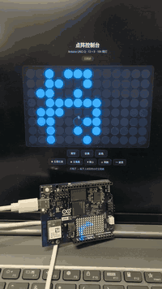

# Arduino UNO Q 点阵控制台

在网页上点格子，板子上 13×8 的 LED 点阵**实时亮起**。



> **演示**：左边是浏览器里的控制台，右边是 UNO Q 板子，两边同步。
> 完整视频：[demo.mp4](https://github.com/metahubaifeel/uno-q-matrix-console/raw/master/demo.mp4)（8 秒，H.264）

---

## 这是什么

[Arduino UNO Q](https://docs.arduino.cc/hardware/uno-q/) 板载一块 **8 行 × 13 列 = 104 颗蓝色 LED** 点阵。

这个项目让你**用浏览器直接画**：点哪个格子，板子上对应的灯就亮。还内置了几个预设图案。

**特点**：不依赖 Arduino App Lab，直接对接板子的 RPC 通道。

---

## 硬件

| 部件 | 型号 |
|---|---|
| MPU（Linux 侧） | Qualcomm Dragonwing QRB2210，4×Cortex-A53，Debian 13 |
| MCU（实时侧） | STM32U585，Cortex-M33，Zephyr |
| 点阵 | 8×13 单色蓝光，104 颗，STM32U585 驱动 |
| 无线 | WiFi 5 双频 + BT 5.1 |
| FQBN | `arduino:zephyr:unoq` |

两颗芯片通过 **Arduino Bridge**（RPC over msgpack）通信。

---

## 架构

```
浏览器（点格子）
     │  HTTP POST /api/pixels
     ▼
matrix-server.py（跑在板子 Linux 侧）
     │  msgpack RPC over /var/run/arduino-router.sock
     ▼
arduino-router（系统服务）
     │  串口 /dev/ttyHS1
     ▼
MCU 上的 sketch → matrix.draw() → 点阵亮
```

---

## 快速开始

### 1. 编译并烧录固件

需要 [arduino-cli](https://arduino.github.io/arduino-cli/) 和 `arduino:zephyr` 核心：

```bash
arduino-cli core install arduino:zephyr

cd firmware/matrix
arduino-cli compile -b arduino:zephyr:unoq --output-dir build .
arduino-cli upload  -b arduino:zephyr:unoq -p /dev/ttyACM0 --input-dir build .
```

> **注意**：在板子自己的 Linux 侧上烧录时，串口是 `/dev/ttyHS1`（不是 `/dev/ttyACM0`）。

### 2. 把服务端传到板子

```bash
adb push server/matrix-server.py /home/arduino/
adb push webui/matrix-ui.html    /home/arduino/
```

### 3. 启动

```bash
adb shell
cd /home/arduino
setsid nohup python3 matrix-server.py --ui /home/arduino/matrix-ui.html > matrix.log 2>&1 < /dev/null &
```

### 4. 打开网页

如果板子和电脑在同一网段且互通：

```
http://<板子IP>:8080
```

**如果电脑防火墙拦了入站**（常见），用 USB 端口转发绕过：

```bash
adb forward tcp:8080 tcp:8080
```

然后访问 `http://127.0.0.1:8080`。

---

## 网页功能

- **点 / 拖动** 画格子，实时同步到板子
- **清空 / 全亮 / 反色**
- **预设图案**：五星红旗、五角星、爱心、笑脸、波浪

---

## API

```http
POST /api/pixels
Content-Type: application/json

{"pixels": "0000000000000..."}
```

`pixels` 是 **104 个字符**，按行排列（每行 13 个），取值 `0`-`7`（8 级灰度，点阵只有单色所以实际非零即亮）。

响应：`{"ok": true}`

```http
GET /health
→ {"ok": true}
```

---

## RPC 协议

板子上 [arduino-router](https://github.com/arduino/arduino-router) 在 `/var/run/arduino-router.sock` 暴露 Unix socket。

**请求**（msgpack 编码）：

```
[0, msgid, method_name, [param1, param2, ...]]
```

**响应**：

```
[1, msgid, result, error]
```

`error` 非 nil 表示调用失败。

本项目的服务端**手写了最小的 msgpack 编码器**（约 20 行），因为板子系统 Python 没装 `msgpack`，也没有 `pip`。

---

## 关于 Arduino App Lab

板子自带的 **Arduino App Lab** 无法启动自定义应用，报错：

```
Sketch "..." Has No Default Profile
```

这是 app-cli 0.7.0 的问题：内嵌的 arduino-cli 读不到 `sketch.yaml` 的 default profile（`arduino-app-cli` 源码 `internal/orchestrator/orchestrator.go` 第 1239 行）。

**本项目就是绕开它的实现。** `app-lab/` 目录里保留了给 App Lab 写的版本（sketch + Python + WebUI brick），等上游修复后可直接使用。

---

## 踩过的坑

1. **点阵数据格式**：用 `matrix.draw(uint8_t[104])`（灰度），不是 `matrixWrite(uint32_t*)`。104 个字节按行排列。
2. **`TMPDIR` 环境变量**：板子上指向不存在的 `/data/local/tmp`，跑 arduino-cli 前要 `export TMPDIR=/tmp`。
3. **App Lab 的容器**：启动很慢且容易卡住，本项目不用它。
4. **防火墙**：电脑的 ufw 会拦住到板子的连接，用 `adb forward` 绕过最省事。
5. **点阵启动占用**：板子 Linux 启动时点阵显示 boot logo 约 20-30 秒，期间别访问。

---

## 目录结构

```
.
├── demo.gif                  # 演示动图
├── demo.mp4                  # 演示视频（8 秒，H.264）
├── firmware/
│   └── matrix/
│       ├── sketch.ino        # MCU 侧：接收像素并画到点阵
│       └── sketch.yaml       # 编译配置
├── server/
│   └── matrix-server.py      # 板子 Linux 侧：HTTP 服务 + RPC 转发
├── webui/
│   └── matrix-ui.html        # 网页控制台（单文件，无依赖）
└── app-lab/                  # Arduino App Lab 版本（上游修复后可用）
```

---

## 许可

MIT
